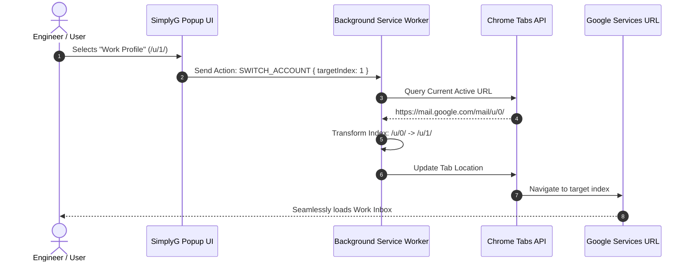

# 🌐 SimplyG — Google Multi-Account Rapid Switcher

  <strong>Streamlined Chrome Manifest V3 Extension for Instant Google Workspace and Multi-Account Session Routing</strong>

  
  
  
  

  <a href="#-security-audit--google-compliance-memorandum">Security & Compliance</a> •
  <a href="#-system-overview">Overview</a> •
  <a href="#-architectural-pipeline">Architecture</a> •
  <a href="#-features">Features</a> •
  <a href="#-installation-guide">Installation</a>

---

## 🔒 Security Audit & Google Compliance Memorandum

> [!IMPORTANT]
> **AUDITOR MEMORANDUM // GOOGLE AUTH INTEGRITY & CREDENTIAL SAFETY**:  
> SimplyG operates with **zero credential interception**:
> - **Zero Password Storage:** The extension never handles, prompts for, or logs Google account passwords or multi-factor authentication (MFA) tokens.
> - **Deterministic URL Routing (`/u/{index}`):** Leverages Google's documented multi-login account indexing standard to safely redirect requests across active sessions.
> - **Privacy-First Storage:** User account labels and visual aliases are stored exclusively on-device in sandboxed Chrome storage.

---

## 📌 System Overview

Professionals handling multiple Google accounts (Personal Gmail, Work Workspace, Freelance, University) frequently encounter Google's dreaded account mismatch page or default account confusion when clicking links.

**SimplyG eliminates login friction** by:
1. Detecting currently active Google login indices (`/u/0/`, `/u/1/`, `/u/2/`).
2. Providing a 1-click switcher popover to reroute any active Google service (Gmail, Meet, Drive, Docs, Cloud Console) to the desired identity.
3. Remembering preferred default profiles per Google service domain.

---

## 🛠️ Architectural Pipeline

---

## ✨ Features

- ⚡ **Instant Keyboard Shortcuts:** Rapidly switch identities without touching your mouse.
- 🎨 **Adaptive Dark & Light Themes:** Matches Google's Material Design 3 design system with fluid CSS transitions.
- 🏷️ **Custom Identity Badging:** Assign company names, avatars, and custom colors to Google session slots.
- 🔒 **Zero Permissions Bloat:** Requests only the minimal required permissions (`tabs`, `storage`) necessary to execute URL indexing.

---

## 🚀 Installation Guide

1. Clone or download `SimplyG-Switcher-Showcase`.
2. Open Google Chrome and enter `chrome://extensions/`.
3. Enable **Developer mode** toggle.
4. Click **Load unpacked** and select the folder `SimplyG-Switcher-Showcase`.
5. Open any Google page (e.g. `mail.google.com`) and click the SimplyG extension icon.

---

**Architected & Engineered by Nikhil**  
*Lead Full-Stack & Systems Platform Developer*

